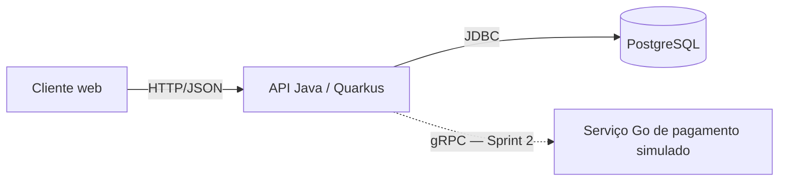
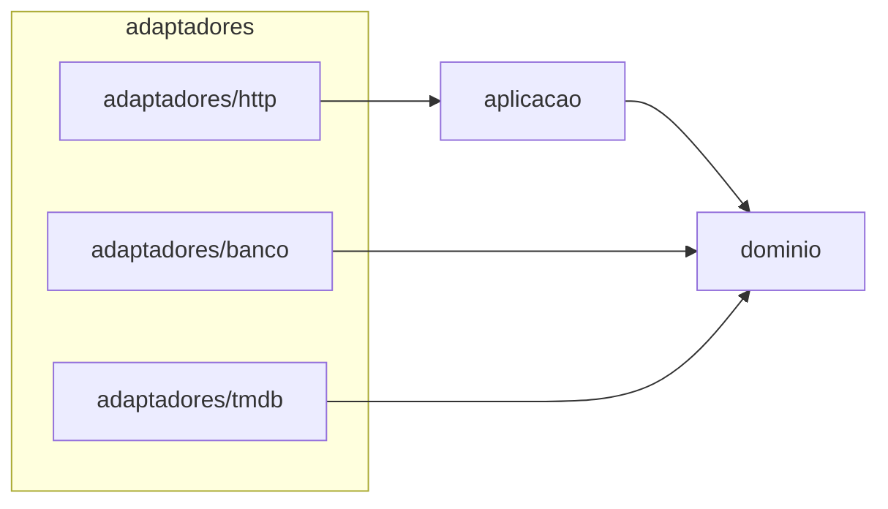

# Arquitetura do BomFilme

Este documento registra a arquitetura definida na Sprint 0. Ele separa o que já funciona na base do projeto das integrações previstas para as próximas sprints.

## Visão geral

A API Java é o serviço principal e a única responsável por persistir dados do domínio. O serviço Go terá uma responsabilidade isolada: simular o processamento de pagamentos. Ele não acessará diretamente o banco da aplicação e não confirmará compras por conta própria.

## Responsabilidades

| Componente | Responsabilidades |
| --- | --- |
| API Java/Quarkus | Regras do negócio, API REST, autenticação, catálogo, sessões, assentos, compras, ingressos, avaliações, persistência e migrações |
| PostgreSQL | Dados do domínio e garantia de restrições, incluindo a exclusividade de assentos por sessão |
| Serviço Go | Cenários reproduzíveis de aprovação, recusa, demora e falha de pagamento simulado |
| Contratos em `protos/` | Mensagens e operações gRPC versionadas entre Java e Go, a partir da Sprint 2 |

## Camadas da API Java

A API é organizada em **um módulo Maven por camada**, com a seta de dependência apontando só para dentro. As convenções de cada camada e o roteiro para adicionar um caso de uso estão em [`api/ARCHITECTURE.md`](../api/ARCHITECTURE.md).

| Módulo e pacote | O que mora nele | O que ele conhece |
| --- | --- | --- |
| `dominio` | Registros (`Cinema`, `Sala`, `Sessao`, `Filme`, ...), portas de repositório, porta do catálogo externo e `ErroDeDominio` | Nada: o pom não declara dependência nenhuma |
| `aplicacao` | Casos de uso (`ServicoDeSessoes`, `ServicoDeFilmes`, ...) | Só as portas do domínio |
| `adaptadores/http` | Recursos REST, mapeadores de exceção, DTOs de entrada e saída | Domínio e casos de uso |
| `adaptadores/banco` | Entidades JPA (`*Entidade`) e implementações Panache das portas | Domínio |
| `adaptadores/tmdb` | Cliente REST do TMDB e o formato de resposta dele | Domínio |

Três consequências práticas dessa separação:

- **O domínio é Java puro, e o compilador garante.** `dominio` é um módulo Maven sem dependências, então um `import jakarta.persistence` ali não compila — a regra não depende de ninguém rodar um teste. As entidades JPA são classes separadas, no adaptador de banco, e nem são visíveis de fora dele.
- **Os casos de uso recusam operações sem conhecer HTTP.** Eles lançam `ErroDeDominio.NaoEncontrado`, `Conflito`, `RegraViolada` ou `ServicoExternoIndisponivel`. Um único mapeador, em `adaptadores/http`, traduz isso para status e *problem details*.
- **Reconhecer um SQLSTATE é conhecimento de persistência.** A tradução de violação de unicidade, chave estrangeira e sobreposição de horários acontece em `adaptadores/banco`, não num `ExceptionMapper` — o que impediria o adaptador HTTP de importar JPA.

A direção entre camadas é garantida pelo build. O que o Maven não cobre é a regra *entre pacotes* dentro de `adaptadores` — que `http` não fale com `banco`, por exemplo — e isso fica em `ArquiteturaTest`, que lê o bytecode com ArchUnit. Um dos casos é um controle que confirma que a regra ainda acusa quando deve.

## Fluxo de compra previsto

1. A API cria a compra pendente e reserva o assento com uma operação segura no banco.
2. A API chama o serviço Go com prazo limite.
3. Uma aprovação confirma a compra e gera o ingresso.
4. Uma recusa libera a reserva e não gera ingresso confirmado.
5. Timeout ou falha de comunicação nunca confirma a compra automaticamente.

A política de expiração e recuperação das reservas será definida junto da implementação da compra na Sprint 2. Essa decisão evita registrar como pronta uma regra que ainda precisa de testes de concorrência e integração.

## Infraestrutura local

O `mise.toml` fixa Java 25 e Go 1.27.1 e fornece uma interface única para build, testes, lint, execução e CI. O `docker-compose.yml` cria uma rede isolada automaticamente e sobe PostgreSQL, API e a imagem do serviço Go. A API aguarda o banco ficar saudável; o serviço Go aguarda a API aceitar conexões.

As imagens usam build multiestágio. Maven e o compilador Go ficam apenas nos estágios de compilação. Os processos finais executam com usuários sem privilégios, sistema de arquivos somente leitura e permissão impedida de obter novos privilégios. Portas e credenciais locais podem ser alteradas pelas variáveis documentadas em `.env.example`; os valores padrão servem apenas ao desenvolvimento local.

## Verificações automatizadas

O comando `mise run ci` executa, em ordem:

1. validação Maven e `go vet`;
2. build Java e Go;
3. testes Java e Go.

O workflow `.github/workflows/ci.yml` executa esse mesmo comando em todo push e pull request. Assim, a verificação local e a verificação do GitHub usam as mesmas versões e tarefas.

## Evolução planejada

- Sprint 1: o serviço de CRUD, com as camadas separadas, migrações, validação, *problem details* e OpenAPI.
- Sprint 2, que é a entrega final (ajuste de 03/10 na disciplina, que substituiu a Sprint 3 e o bloco final): contratos em `protos/`, servidor gRPC em Go, testes de pagamento e concorrência, publicação com banco gerenciado, e a suíte de testes unitários, de integração e de arquitetura verde local e no CI.
